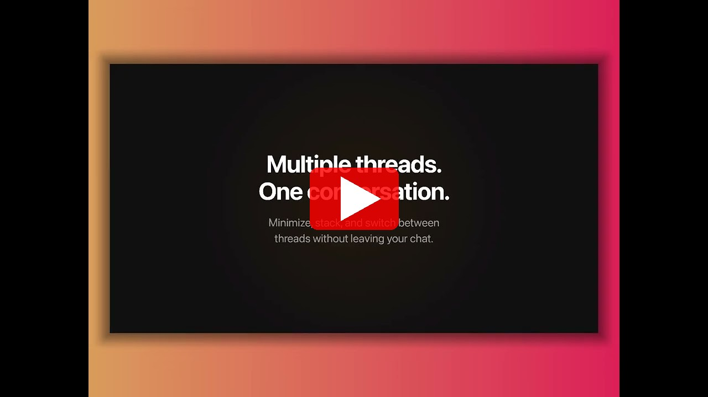

# Tangent – Threaded Chat for Claude & ChatGPT

**Branch off into side threads without leaving your main conversation.**

[](https://chromewebstore.google.com/detail/tangent-%E2%80%93-threaded-chat-f/dhacmfmpmgedcagknopapipcgcfcpaae)

[](https://www.youtube.com/watch?v=1BIQE1X34EA)

## The Problem

You're deep into a conversation — Claude just gave you a dense, perfectly-worded breakdown of a complex topic. Or ChatGPT explained something that finally clicked. But now you have a follow-up question.

So you type it. You get a response. You scroll back up. Then another question. More scrolling. The thing you were studying is now buried under twelve messages of back-and-forth, and your flow state is gone.

**Your options today:**
1. Ask the follow-up in the same thread → pollutes your clean conversation
2. Open a new tab → lose context, friction, disjointed experience
3. Just don't ask → lost learning opportunity

## The Solution

Tangent fixes this — on both Claude and ChatGPT.

Select any text in your conversation and open a threaded side panel: a fresh, temporary chat that lives right next to your main conversation. Ask follow-up questions, dig deeper, explore rabbit holes. Your main conversation stays exactly where you left it.

**No scrolling. No context switching. No lost trains of thought.**

## How It Works

1. **Select text** in any Claude or ChatGPT conversation
2. **Click "Open Thread"** on the selection button that appears (or press `Cmd+\` for a blank thread)
3. **A floating panel opens** with a fresh, temporary chat session
4. **Your selected context** is automatically pasted into the new thread for easy reference
5. **Minimize threads to tabs**, expand them later — you'll be scrolled right back to where you branched off

## Features

### Works on both platforms
- **claude.ai** — hijacks Claude's native "Reply" selection button
- **chatgpt.com** — hijacks ChatGPT's native "Ask ChatGPT" selection button

### Built for deep learning sessions
- **Multiple simultaneous threads** — open different threads for different topics
- **Temporary by default** — each thread runs in temporary/incognito mode, no clutter in your sidebar
- **Minimize & restore** — minimize a thread, keep reading, restore it later with a single click
- **Visual scroll-back** — when you re-open a minimized thread, the original text highlights so you instantly reconnect with the context

### Keyboard shortcuts
| Shortcut | Action |
|----------|--------|
| `Cmd+\` | Open a blank thread |
| `Cmd+Shift+T` | Open a thread from current selection |
| `Escape` | Minimize the active thread |

### Lightweight & private
- Runs entirely locally in your browser
- No external network requests beyond loading claude.ai or chatgpt.com in the panel
- No data collection, no analytics, no tracking
- Uses your existing Claude or ChatGPT subscription — no API key needed
- Open source

## Installation

### From Chrome Web Store

[**Install Tangent from the Chrome Web Store**](https://chromewebstore.google.com/detail/tangent-%E2%80%93-threaded-chat-f/dhacmfmpmgedcagknopapipcgcfcpaae)

### Chrome — From Source (Developer Mode)

1. Clone or download this repository
2. Open Chrome and navigate to `chrome://extensions/`
3. Enable **Developer mode** (toggle in top-right)
4. Click **Load unpacked**
5. Select the repository root folder (it contains `manifest.json`)
6. Navigate to [claude.ai](https://claude.ai) or [chatgpt.com](https://chatgpt.com) and start using Tangent

### Firefox — From Source

Firefox needs its own manifest (`manifest.firefox.json`), so build the Firefox package first:

```bash
./build.sh firefox      # produces dist/firefox/ and dist/tangent-firefox-<version>.zip
```

Then load it temporarily:

1. Open Firefox and navigate to `about:debugging#/runtime/this-firefox`
2. Click **Load Temporary Add-on…**
3. Select `dist/firefox/manifest.json`
4. Navigate to [claude.ai](https://claude.ai) or [chatgpt.com](https://chatgpt.com)

> **Requires Firefox 128+.** Firefox only supports the `declarativeNetRequest` header
> modification (used to embed ChatGPT in the panel iframe) from version 128 onward.
> Temporary add-ons are removed when Firefox restarts; for a permanent install the
> add-on must be signed via [addons.mozilla.org](https://addons.mozilla.org).

### Building distributable zips

`build.sh` assembles both browser packages from the shared source:

```bash
./build.sh              # build both Chrome + Firefox
./build.sh chrome       # Chrome only
./build.sh firefox      # Firefox only
```

Output lands in `dist/` (a `<target>/` unpacked folder plus a `.zip` for each target).
The only difference between the two is the manifest — all logic, styles, and rules are shared.

## Why Tangent?

Claude and ChatGPT are incredible for learning complex topics — programming concepts, research papers, technical documentation. But the single-thread chat format forces a painful choice: keep reading or ask a question. Tangent removes that trade-off. Branch off, explore, come back. Your reading flow stays intact.

**Stop scrolling. Start branching.**

## File Structure

```
tangent/
├── manifest.json          # Chrome extension config (Manifest V3)
├── manifest.firefox.json  # Firefox manifest (adds browser_specific_settings)
├── build.sh               # Builds Chrome + Firefox packages from shared source
├── content.js             # Main logic: selection, button, panel, iframe
├── styles.css             # UI styling
├── rules.json             # declarativeNetRequest rules (strips iframe headers for ChatGPT)
├── icons/                 # Extension icons
│   ├── icon16.png
│   ├── icon48.png
│   └── icon128.png
├── images/                # Screenshots
└── README.md
```

`content.js`, `styles.css`, and `rules.json` are identical across browsers — only the
manifest differs, so there's a single source of truth for all the actual behavior.

## Configuration

Key settings are at the top of `content.js`:

```javascript
const CONFIG = {
  minSelectionLength: 10,  // Minimum characters to trigger the Open Thread button
  panelWidth: 480,         // Default panel width in pixels
  panelHeight: 600,        // Default panel height in pixels
  panelMargin: 20          // Panel margin from viewport edge
};
```

## Known Limitations

- **Iframe dependency** — The panel loads Claude or ChatGPT in an iframe. Security header changes on either platform may break this (a fallback "open in new tab" button is provided).
- **Auto-paste** — Works in most cases, but may occasionally fail if the page is slow to load. Manual paste (`Cmd+V`) always works as a fallback.
- **Dark mode only** — Currently styled for dark themes.

## Contributing

Issues and PRs welcome. Potential improvements:

- [ ] Lazy unload minimized iframes (memory optimization)
- [ ] Thread history / persistence across sessions
- [ ] Gemini support
- [ ] Customizable keyboard shortcuts

## License

MIT License. See [LICENSE](LICENSE) for details.
